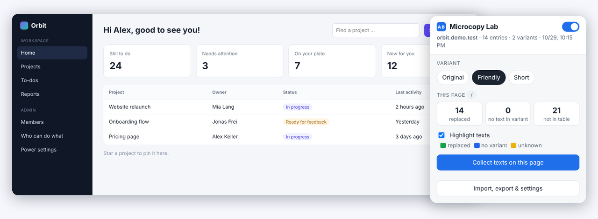

# Microcopy Lab

**Test wording variants on any website — without touching code.**

Microcopy Lab is a Chrome extension that replaces titles, labels, buttons, placeholders
and tooltips on a website according to a simple spreadsheet. Prepare as many wording
variants as you like and switch between them live — for usability tests, UX writing
reviews, stakeholder demos and localisation checks.

[Website](https://stephansx.github.io/microcopy-lab/) ·
[Privacy policy](https://stephansx.github.io/microcopy-lab/privacy.html)



---

## How it works

1. **Enable a website.** Open your site — web apps behind a login work too — and enable
   Microcopy Lab for it from the toolbar popup. It runs nowhere else.
2. **Collect the texts.** Click through the pages. Every visible text, placeholder and
   tooltip is collected automatically.
3. **Write your variants.** Export to Excel or CSV and add one column per variant.
   An empty cell keeps the original text.
4. **Switch and test.** Import the file — or link a Google Sheet — and pick a variant
   in the popup. No reload, no deployment.

## Features

- Works in modern single-page apps (React, Angular, Vue …): texts that load later or
  change on the fly are replaced too
- Unlimited variants per table, switched live from the popup
- Rules per page (`/settings/*`), with IDs in addresses matched automatically
- Placeholders: `{n} items` → `{n} products`
- Replaces visible text, input placeholders, tooltips and `aria-label`s
- Import from `.xlsx`, `.csv` or a shared Google Sheet, with a validation report
- Highlight mode marks replaced, empty and unknown texts
- Test links: `?_variant=B` opens a page directly in that variant
- Interface in English and German

## The table

| page | type | original | Friendly | Short |
|---|---|---|---|---|
| `*` | text | Tasks | To-dos | To-dos |
| `/` | text | Welcome back, Alex! | Hi Alex, good to see you! | Hi Alex |
| `/settings/*` | text | Advanced settings | Power settings | |
| `*` | placeholder | Search projects | Find a project … | Search |

- **page** — `*` everywhere, a path for one screen, `/settings/*` including sub-pages.
  Numeric and UUID segments in addresses become `:id` automatically. More specific
  entries win.
- **type** — `text` (visible), `placeholder` (input fields), `tooltip` (`title`) or
  `aria` (`aria-label`). Empty means `text`.
- **Every other column** becomes a variant. `note`, `found`, `id` and `key` are ignored.
  German headers (`seite`, `typ`, `notiz`) are understood as well.

See [`store/beispiel-tabelle.csv`](store/beispiel-tabelle.csv) for a complete example.

## Installation

### From the Chrome Web Store

Not published yet — this section will link to the listing once it is live.

### From source

1. Download this repository (**Code → Download ZIP**) and unpack it, or clone it.
2. Open `chrome://extensions` and switch on **Developer mode** (top right).
3. Click **Load unpacked** and select the `extension/` folder.
4. Pin the extension and open the website you want to test.

Works in Chrome and other Chromium-based browsers (Edge, Brave, Vivaldi, Opera) from
version 111 onwards.

## Privacy

No account, no server, no analytics, no tracking. Tables, settings and collected texts
are stored only in your own browser (`chrome.storage.local`). The extension runs only on
websites you enable yourself, and the one network request it ever makes is downloading a
table from an address you entered.

Full text: [PRIVACY.md](PRIVACY.md) ·
[online](https://stephansx.github.io/microcopy-lab/privacy.html)

## Development

```
extension/   the extension itself (load this folder unpacked)
docs/        the website, served by GitHub Pages
test/        unit tests and end-to-end tests (Playwright)
tools/       generator for the _locales message files
store/       Chrome Web Store listing texts, screenshots, checklist
```

```bash
npm install
npx playwright install chromium   # once

npm run test:unit    # table parsing, lookup, export
npm run test:e2e     # loads the extension in Chromium against two demo sites
npm run smoke        # production build: no page errors, no host permissions
npm run build        # writes microcopy-lab.zip for the Web Store
```

Interface strings live in `tools/messages.py`, which generates
`extension/_locales/{en,de}/messages.json`. Edit the Python file, then run
`npm run messages` — never edit the JSON by hand.

The extension has no build step and no runtime dependencies: the files in `extension/`
are shipped as they are. The small XLSX reader and writer in
`extension/lib/xlsx-mini.js` is written from scratch so that no third-party library has
to be bundled.

## Contributing

Issues and pull requests are welcome. For a change to the interface texts, please edit
`tools/messages.py` and regenerate, so that English and German stay in sync.

## License

[MIT](LICENSE) © Stephan Weibel, Weibel Consulting

---

## Kurz auf Deutsch

Microcopy Lab ist eine Chrome-Erweiterung, die Titel, Beschriftungen, Buttons,
Platzhalter und Tooltips auf einer Website nach einer einfachen Tabelle ersetzt. So
lassen sich beliebig viele Textvarianten live im echten Produkt testen — für
Usability-Tests, UX-Writing-Reviews und Übersetzungsprüfungen.

Die Oberfläche der Erweiterung gibt es auf Deutsch und Englisch, und deutsche
Spaltennamen in der Tabelle (`seite`, `typ`, `notiz`) werden ebenfalls verstanden.
Alle Daten bleiben im eigenen Browser.
